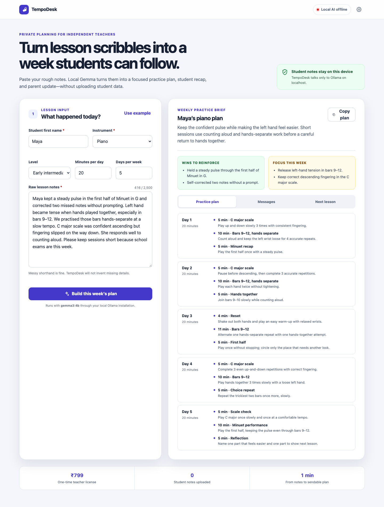
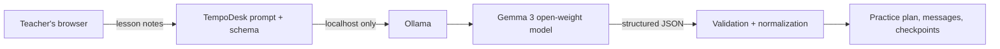

# TempoDesk

TempoDesk is a local-first lesson-planning assistant for independent music teachers. Paste rough lesson notes and a local Gemma model turns them into a realistic weekly practice plan, a student recap, a parent update, and concrete next-lesson checkpoints.

**Live demo:** <https://shaikhubaidahmed.github.io/tempodesk/>

No student notes are sent to a hosted AI service. The browser talks directly to [Ollama](https://ollama.com/) on `localhost`.



## Why this exists

Independent music teachers often finish a day with shorthand notes and several follow-up messages still to write. Generic AI tools can help, but uploading notes about students—often minors—to a third-party service is a poor default. TempoDesk keeps that workflow on the teacher's own computer and turns the output into something immediately useful.

## Features

- Local Gemma inference through Ollama; no account or API key
- Evidence-grounded prompt that records missing information instead of inventing it
- Exactly time-boxed practice days with observable goals
- Ready-to-send student and parent messages
- Keyboard-accessible tabs, validation, focus states, reduced-motion support, and responsive layout
- Offline sample result so the interface can be evaluated without a model download
- No runtime dependencies and no build step

## Run locally

Requirements: Node.js 18+ and Ollama.

```bash
ollama pull gemma3:4b
npm start
```

Open <http://localhost:4173>. TempoDesk checks `http://localhost:11434` automatically. Use the settings button if Ollama is running on a different localhost port or if you prefer `gemma3:1b`.

If Ollama blocks browser requests on your system, start it with the local app origin allowed:

```bash
OLLAMA_ORIGINS=http://localhost:4173 ollama serve
```

TempoDesk deliberately rejects non-local Ollama URLs to preserve its privacy promise.

## Try the demo

1. Select **Use example**.
2. Select **Build this week's plan**.
3. If Gemma is not installed, select **Preview sample result**.
4. Explore the practice, messages, and next-lesson tabs.

The hosted version also has a **Preview sample plan** button for judges and visitors who do not have Ollama running.

## Architecture



The AI does the work that rules cannot: interpreting shorthand lesson observations and adapting practice language to the student. Deterministic code then validates the response, limits list sizes, enforces the requested number of days, and reconciles each day's time blocks.

## Test

```bash
npm test
npm run check
```

The `?demo=1` URL flag loads the included sample plan for screenshot and layout verification without contacting Ollama.
When Node is unavailable, serve the repository and open `/test/browser.html` to run the core checks in a browser.

## Privacy and limitations

- Data remains local unless the user changes the code; the settings UI accepts only loopback hosts.
- Local model output can still be wrong. The teacher remains responsible for reviewing every plan.
- TempoDesk is an administrative teaching aid, not a substitute for a qualified teacher or a medical/therapeutic tool.
- Browser storage contains only the Ollama URL and model name, never lesson notes.

## Challenge

Built for the [Hacktoberfest Open-Source AI Challenge Week 2: Side Hustle](https://dev.to/challenges/hacktoberfest-week2-2026-10-12). TempoDesk qualifies for **Best Use of Gemma** because Gemma's local inference is the core transformation engine.

## License

[MIT](LICENSE)
