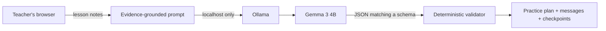

*This is a submission for the [Hacktoberfest Open-Source AI Challenge Week 2: Side Hustle](https://dev.to/challenges/hacktoberfest-week2-2026-10-12).*

## What I Built

A music lesson rarely ends when the student leaves.

Independent teachers still have to turn hurried notes such as "left hand tense in bars 9 to 12, count aloud, C major fingering slipped down" into something a student can actually practise. Then they often write a second version for a parent and decide what to check next week. Multiply that by a full afternoon of students and the unpaid admin adds up quickly.

I built **TempoDesk**, a local-first planning assistant for independent music teachers. A teacher pastes rough lesson notes, chooses the student's instrument and available practice time, and TempoDesk produces:

- a realistic, time-boxed practice plan;
- wins worth reinforcing and focus areas for the week;
- a student-friendly recap;
- a concise parent update;
- measurable checkpoints for the next lesson; and
- explicit questions wherever the notes do not contain enough information.

Lesson notes can contain details about children, their progress, and their schedules. TempoDesk sends them only to an Ollama server on the teacher's own computer. The settings screen rejects non-localhost model URLs, and the browser never stores lesson notes.

Who would pay for it? The target user is a solo music teacher with 15 to 40 students who loses an hour or two each week to follow-up messages and practice-plan admin. My proposed product is a ₹799 (about $10) packaged edition with a one-click installer and setup help. The open-source web version remains free. Teachers would pay once for easier setup and support, with no subscription.


## Demo

[Open the live TempoDesk demo](https://shaikhubaidahmed.github.io/tempodesk/)

The hosted demo includes a **Preview sample plan** button, so it can be explored without installing a model. The sample is labeled clearly and does not pretend to be a live AI response.

Run it locally:

```bash
ollama pull gemma3:4b
npm start
```

Then open `http://localhost:4173` and select **Use example**. If Ollama is not available, **Preview sample plan** shows the complete product flow without pretending that the sample came from a live model.

For a screenshot-ready demo state, open `http://localhost:4173/?demo=1`.

## Code



[Browse the source code on GitHub](https://github.com/shaikhubaidahmed/tempodesk)

The project is MIT licensed, dependency-free at runtime, and includes focused tests for input validation, prompt construction, Ollama response parsing, output normalization, and copyable plan formatting.

I also tested the complete local model path with `gemma3:4b`: Ollama returned schema-valid JSON with the requested number of practice days and exact per-day minute totals.

## How I Built It

TempoDesk is a small static web app built with semantic HTML, CSS, and JavaScript. It talks directly to Ollama's local `/api/chat` endpoint and uses **Gemma 3 4B** as its default open-weight model.



The model and ordinary code have separate jobs.

Gemma handles the part that benefits from language understanding: reading messy teaching shorthand, finding the learning priorities, adapting the tone for a student or parent, and turning observations into clear practice targets.

JavaScript handles predictable checks. TempoDesk validates the JSON, trims unbounded lists, enforces the requested number of practice days, reconciles every day's block minutes, escapes all rendered content through DOM text nodes, and falls back to safe defaults when a field is missing.

The prompt has a strict evidence rule. When the teacher leaves out a useful fact, the model adds a question to `unknowns`. In the sample, it asks which tempo is comfortable because the notes contain no metronome number.

The interface was designed around a fast two-step workflow: notes on the left, a sendable plan on the right. It includes visible labels and focus states, keyboard-operable tabs, an error summary that receives focus, 44px-or-larger controls, reduced-motion support, and responsive layouts tested at desktop and 390px mobile widths.

### Scope choices

The MVP does not keep a student database, sync notes, send messages automatically, or require an account. Those features would weaken the privacy story and expand the project before the core workflow was proven.

The local-model dependency stays visible. The interface shows the connection status and settings, errors explain how to install the model, and the offline sample is clearly labeled.

## Why Does Open Innovation Matter?

Open weights change the economics and the trust model of this product.

A cloud AI version would create a recurring inference bill for every lesson plan. I would either have to charge a subscription, ration usage, or silently send sensitive lesson notes to another company. Local Gemma makes the marginal inference cost effectively zero after the teacher owns the laptop and downloads the model. That makes a low-cost one-time license believable for a solo teacher.

It also gives the teacher control. They can work without an internet connection, choose a smaller Gemma model for an older laptop, inspect the prompt, change the behavior, or replace the model entirely. Their notes do not become someone else's data-retention decision, and the product does not break because an API price or policy changes.

Gemma performs the central transformation. Without its ability to interpret unstructured lesson observations and produce audience-specific language, TempoDesk would be a rigid form template.

## Prize Categories

- Best Use of Gemma: Gemma 3 runs locally through Ollama and performs the lesson-notes-to-practice-plan transformation.

## What I Learned

The `unknowns` field was more effective than adding another instruction to "be accurate." It gives missing information somewhere to go, so the model can ask for a tempo, fingering edition, or deadline when the notes do not supply one.

Local-first UX needs to treat model setup as part of the product. A private architecture still needs a visible connection state, an actionable missing-model error, a smaller-model option, and a demo path that works before a multi-gigabyte download finishes.

TempoDesk covers one lesson at a time and produces one useful week. Keeping that boundary made the workflow specific enough for a teacher to use.
